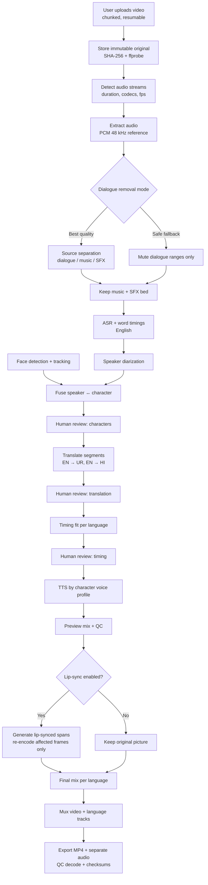
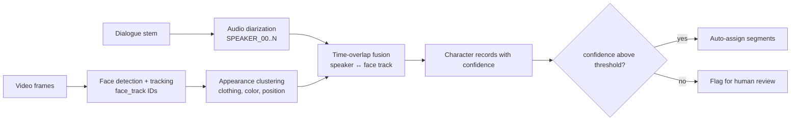
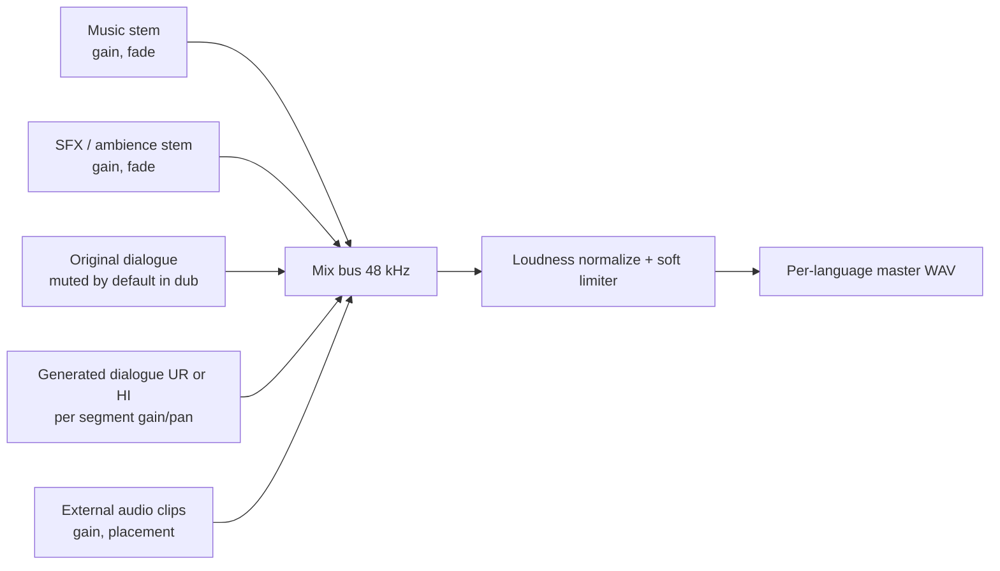
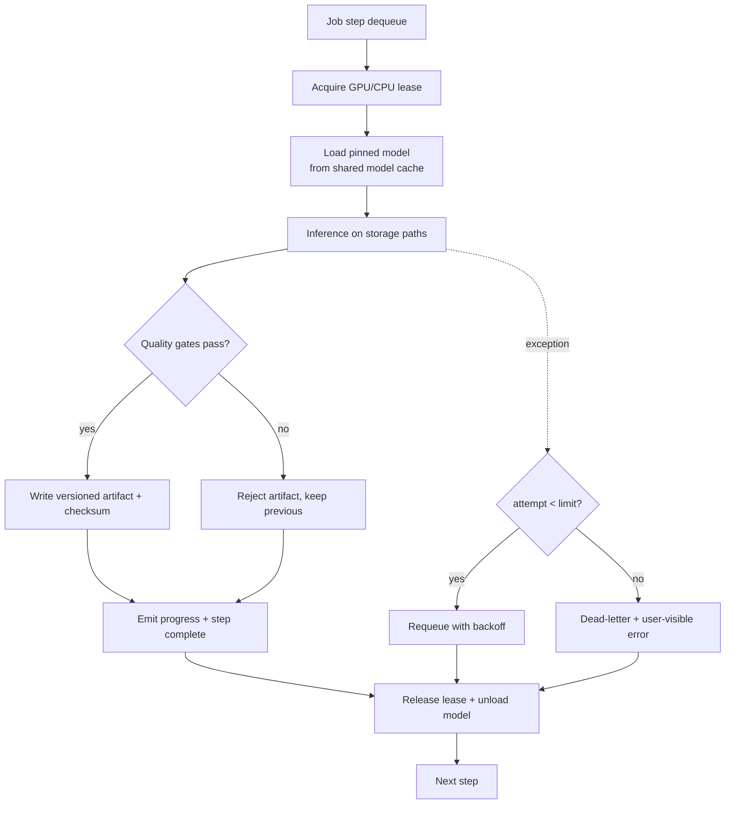

# CINEMA AI DUB — AI Pipeline and Processing Architecture

**Phase:** Phase 1 — Project Architecture (documentation only)
**Status:** Proposed. No pipeline code, model download or inference has been performed.

---

## 1. Purpose and scope

This document defines every processing stage from video upload to final export, plus the editor and track architectures that surround it. All stages run **centrally on the server**. Only model *types* are named here; concrete version pinning happens during implementation, under the license rules in `TECHNOLOGY_STACK.md`.

---

## 2. End-to-end video dubbing workflow

### 2.1 Human checkpoints

| Checkpoint | What the user confirms | Why |
|---|---|---|
| Characters | Diarization labels ↔ detected faces/appearances | Automatic fusion is probabilistic. |
| Translation | Urdu/Hindi text per segment | Machine translation of film dialogue needs cultural review. |
| Timing | Start/end per segment per language | Target text is often longer than English. |
| Voice | Sample line per character | Prevents an entire dub with the wrong voice. |
| Lip-sync | Sample 5-second span | Avoids spending hours on a bad model for the whole film. |
| Final mix | Relative music/SFX/dialogue levels | Subjective; always user-controlled. |

---

## 3. Video processing pipeline (Phase 3)

1. **Upload validation:** extension allowlist, MIME sniffing, size/quota check, chunk assembly, SHA-256 verification.
2. **Probe:** `ffprobe` extracts duration, resolution, fps, pixel format, color metadata, video/audio codecs and stream layout. Stored in `videos.probe`.
3. **Keyframes and thumbnails:** sparse thumbnails for the browser; waveform peaks generated from audio for the editor.
4. **Audio extraction:** decode original audio to 48 kHz stereo PCM WAV as the reference for all downstream stages; keep the original compressed stream for stream-copy export.
5. **Frame indexing:** map timecode ↔ frame number using the source fps; all lip-sync frame ranges derive from this map.
6. **Non-destructive rule:** originals are immutable. Every derived artifact is written to a new key and linked to `media_assets`.

**Quality preservation strategy**

| Situation | Action |
|---|---|
| No lip-sync and no visual edit | `-c:v copy` — bit-exact original video. |
| Lip-sync on some spans | Re-encode only those spans with matched codec/profile/bitrate/color settings; concatenate; keep untouched spans stream-copied. |
| Resolution/fps conversion required for a model | Never applied to the final master — model input is a temporary working copy. |
| Crop/pad/scale needed for lip-sync model | Revert to original framing via masked blend; validate with frame comparison. |

---

## 4. Audio extraction and separation pipeline (Phases 4 and 5 — Original Dialogue Control)

1. Extract the original audio stream to lossless PCM.
2. Detect stream layout (mono/stereo/5.1) and normalize to a working stereo mix while retaining the original.
3. Run source separation (Demucs-class model) to produce three stems:
   - `dialogue` — speech band, used only for ASR/diarization reference and optional removal.
   - `music`
   - `sfx` (residual/ambience).
4. Quality gates:
   - Stem duration must match source within one frame.
   - Silence/ratio checks to detect failed separation.
   - If separation confidence is low, automatically fall back to **mute-only** mode: attenuate dialogue only in confirmed speech intervals, preserving the rest of the original mix.
5. User controls: per-stem gain, mute, solo, and the ability to replace the music/SFX bed with the original audio minus speech.

Documented limitation: "preserve music and SFX as much as possible" is a best-effort goal. Separation leaks and artifacts are expected; the architecture always offers a manual fallback.

---

## 5. Speech recognition and transcription pipeline

1. Input: extracted audio or dialogue stem.
2. Engine: local Whisper-class model (fine-tuned variants evaluated later), with language hint `en`.
3. Outputs:
   - Segment-level text with `start_ms` and `end_ms`.
   - Word-level timestamps for precise timing.
   - Confidence scores per segment; low-confidence segments flagged.
4. Post-processing:
   - Split overly long segments at natural pauses.
   - Merge overlapping segments from the same speaker.
   - Restore punctuation/casing for translation quality.
   - Store as `dialogue_segments` with `revision = 1`.
5. User correction: text edits create a new revision; translation and TTS depend on the current revision.
6. Recovery: ASR step is idempotent; its output key includes audio checksum + model revision, so retries reuse cached results.

---

## 6. Speaker and character detection pipeline

- **Audio side:** diarization produces speaker labels and turn boundaries with confidence.
- **Visual side:** face detection/tracking produces face tracks; appearance clustering groups repeated characters.
- **Fusion rule:** a speaker turn and a face track are associated when their time intervals overlap significantly and the face is active (mouth region visible, person on screen). Off-screen narration stays unassigned to a face.
- **Output:** `characters` rows with `diarization_label`, `face_track_ids`, `confidence`; `dialogue_segments.character_id` set where confident.
- **Human review:** user can merge/split characters, reassign segments, and name them. All corrections are stored as first-class data, not overrides in memory.
- **Consistency:** character ID is the key used by voice profiles, TTS and lip-sync — this is what guarantees one voice per character throughout the film.

---

## 7. Translation pipeline

1. Input: current `source_text` of each `dialogue_segments` row.
2. Engines (all local/self-hosted; no paid API):
   - Primary: NLLB-200-class multilingual MT.
   - Alternative for Indic languages: IndicTrans2-class model.
   - Optional local LLM for style/lip-friendly rewrites, used only with a small, pinned model and deterministic settings.
3. Flow:
   - Translate per segment with neighboring context (previous/next 1–2 lines) to preserve pronouns and tone.
   - Normalize Urdu/Hindi scripts and numerals; preserve names and proper nouns via a glossary per project.
   - Score output heuristically (length ratio, repetition, empty output) and flag anomalies.
   - Write `translations` rows for `ur` and `hi`; user approves or edits.
4. Lip-friendly rewriting: if `target_duration < spoken_duration`, propose a shorter wording rather than aggressive time-stretch. The user chooses.
5. Audit: engine, model revision and source-text hash stored per translation; changing source text invalidates the translation for re-review.

---

## 8. Character voice profile architecture

A voice profile is an immutable, versioned definition attached to a character:

| Field | Purpose |
|---|---|
| `engine`, `model_id`, `model_revision` | Reproducible synthesis. |
| `reference_asset_id` | Optional user-owned sample for voice cloning (consent required). |
| `consent_status` | `none / pending / granted / revoked`. |
| `characteristics` | `deep, heavy, soft, male, female` plus pitch, speed, timbre, emotion scalars. |
| `params` | Seed, temperature, language hints, prosody controls. |
| `embedding_key` | Cached speaker embedding for consistent cloning. |

Rules:

- One **active** profile per character; previous profiles are retained so old TTS outputs remain explainable.
- Changing a profile creates a new version; it never mutates previously generated takes.
- Urdu and Hindi can use different engines if quality requires, but the *character identity* remains the same UUID.
- Built-in voices must be license-cleared for the intended use; no non-commercial sample is bundled.
- Customization controls map to engine parameters through an adapter, so the UI talks in human terms (deep/soft/heavy) rather than model-specific numbers.

---

## 9. Natural voice generation pipeline

1. For each approved translation and character, resolve the active voice profile and language.
2. Generate candidate audio takes (default 1–2; more on demand) with fixed seed.
3. Post-process: loudness normalization, DC offset removal, de-click, sample-rate alignment to 48 kHz.
4. Validate: duration vs target window, clipping, empty/silent output, sample-rate match.
5. Store each take in `tts_outputs` with `params_hash`; the user selects the preferred take per segment.
6. Consistency QA: periodically synthesize a fixed calibration sentence per character to detect voice drift across long films.
7. Batching: segments are grouped per character/language so the TTS model loads once and stays resident under a GPU lease.
8. Failure handling: a failed segment is retried individually; other segments are unaffected.

---

## 10. Dialogue timing and synchronization architecture

- **Authoritative clock:** source video frame timeline in milliseconds (`videos.duration_ms`, fps map).
- Each segment has original `(start_ms, end_ms)` and per-language adjusted values in `timing_adjustments`.
- **Fitting strategies, in preference order:**
  1. Fit within original span after translation rewrite.
  2. Insert/expand silence at sentence-internal pauses.
  3. Mild time-stretch (bounded, quality-checked; user-visible ratio).
  4. Manual boundary edit in the timeline (always available).
- **Lip-sync alignment:** generated speech start is aligned to the original mouth-activity window; offsets are stored explicitly, not assumed.
- **Overlap guard:** segments for the same character cannot overlap; cross-character overlaps are permitted up to a configured tolerance and flagged.
- **Export timing:** mixes are rendered at exact source duration; no drift is allowed between video and audio.

---

## 11. Audio mixing architecture

A deterministic mix graph is built from `audio_tracks` and segment placements:

- Per-track controls: gain (dB), pan, mute, solo, fades, placement.
- Per-segment controls: gain, offset, take selection.
- Loudness target configurable (broadcast-style target as default, user-adjustable).
- Mixes are rendered per language; the original English mix is always retained.
- Rendering is a CPU worker job; preview mixes are lower-fidelity and regenerated after edits.
- No destructive edits: all mix state lives in the database and is reproducible from it.

---

## 12. AI Lip Sync architecture (Phase 13 — AI Lip Sync & Facial Synchronization)

1. **Scope selection:** only segments where the character is on screen and speaking are eligible. Off-screen dialogue is skipped.
2. **Input:** original video fragment + final per-language dialogue audio for that segment.
3. **Engine options (local models):**
   - Human faces: LatentSync-class or MuseTalk-class model.
   - Non-human/animated faces: audio-driven avatar model where suitable; availability is a quality gate, not a promise.
4. **Frame mapping:** exact start/end frames from the fps map; handle edge cases at segment boundaries with a small blend window.
5. **Quality gates:**
   - Output frame count must match expected count.
   - Visual similarity outside the mouth region must remain within a configured threshold.
   - Mouth-open vs audio-energy correlation checked on a sample.
   - Failed spans are rejected and the original frames are kept, with a warning.
6. **Reintegration:** modified fragments replace only their source frame ranges; untouched video stays stream-copied.
7. **GPU discipline:** lip-sync runs under an exclusive GPU lease, one span batch at a time; model unload after batch to release memory.
8. **Optionality:** lip-sync can be disabled globally or per character; dubbing without lip-sync is a fully supported output.

---

## 13. Multilingual audio track architecture (Phases 12 and 16)

Export set for a project with Urdu and Hindi targets:

| Deliverable | Content |
|---|---|
| `master_all_tracks.mp4` | Original video + Original English, Urdu Dub, Hindi Dub audio tracks (plus music/SFX bed where supported). |
| `dub_urdu.mp4` | Video + Urdu dub master. |
| `dub_hindi.mp4` | Video + Hindi dub master. |
| `audio_original.wav`, `audio_urdu.wav`, `audio_hindi.wav` | Standalone masters. |
| `stems/` | Dialogue, music, SFX stems for further editing. |

- Track metadata: language tag, title, role (`original`, `dub`, `bed`), default-flag selection.
- Browser limitation (assumption A9): standard MP4 multi-audio support varies; therefore separate per-language files are always produced in addition to the multi-track master.
- Subtitles (if enabled later) follow the same language keys.

---

## 14. Professional timeline editor architecture (Phase 14 — design target, not implemented)

- **Tracks:** video, original dialogue, music, SFX, character dialogue lanes per language, external audio lanes.
- **Clips:** each segment/asset has start, duration, gain, fades, take selection and source reference.
- **Operations:** trim, split, move, ripple/roll, fade, gain, mute/solo, snapping to frames/word boundaries, undo/redo.
- **Collaboration model:** edits are small JSON operations appended to a `timeline_edits` log (schema addition during implementation) and reconciled server-side; `dialogue_segments`, `timing_adjustments` and `audio_tracks` hold the materialized state.
- **Waveforms:** server-generated peak JSON at multiple resolutions; mobile downloads only the resolution it displays.
- **Preview:** lightweight mix rendered on demand; final mix rendered at export.
- **Performance:** segment-level virtualization; never load full PCM into a browser.
- **Conflict control:** server validates overlaps and revision numbers; stale edits are rejected with a merge prompt.

---

## 15. External audio import architecture (Phase 14)

1. Accept common formats (WAV, MP3, FLAC, M4A, AAC, OGG) with the same validation as video uploads.
2. Probe, normalize to 48 kHz, compute peaks, store as `media_asset` kind `external_audio`.
3. User assigns an imported clip to:
   - a character (replaces/overrides that character's generated dialogue for a span), or
   - a free audio lane (music/SFX bed extension).
4. If assigned to a character, its duration is compared with the segment window; fitting rules from §10 apply, or the user adjusts boundaries.
5. External audio is never re-synthesized; it is mixed directly and tagged with `source = imported` for audit.
6. Rights reminder: user confirms the sample is theirs or licensed (consent/rights flag).

---

## 16. Final video and audio export architecture (Phase 16)

1. **Preflight:** verify all referenced artifacts exist, checksums match, durations fit, and no segment is unresolved.
2. **Render mixes** per language at exact source duration.
3. **Reintegrate lip-sync fragments** if enabled; otherwise stream-copy original video.
4. **Mux** using FFmpeg with explicit stream mapping and language metadata.
5. **QC:** decode entire output, compare frame count/duration with source, verify each audio stream is non-silent, check A/V offset.
6. **Package:** write outputs to `exports/`, create `exports`/`export_tracks` rows, generate signed download URLs.
7. **Presets:** original-only, Urdu dub, Hindi dub, all-tracks, audio-only, stems bundle.
8. **Failure:** QC failure blocks download and produces a diagnostic report instead of a broken file.

---

## 17. Error handling and job recovery

| Failure | Detection | Recovery |
|---|---|---|
| Upload interrupted | Chunk checksum mismatch | Resume or restart chunk; no orphan final object. |
| Probe failure | ffprobe error | Mark video `probe_failed`; user re-uploads. |
| Model load OOM | Worker memory guard / CUDA OOM | Release lease, requeue with smaller batch; persistent failure → dead-letter with clear reason. |
| Step timeout | Per-step watchdog | Retry with backoff, then dead-letter. |
| Worker crash | Lease heartbeat expiry | Step requeued; deterministic output key prevents duplicates. |
| Invalid AI output | Quality gates | Reject artifact, keep previous good artifact, warn user. |
| Export QC failure | Decode/duration checks | Block download, provide diagnostics, allow retry. |
| User cancellation | Cancel flag | Cooperative stop at safe boundary; partial artifacts cleaned up. |

User-facing errors always say **what failed, what was preserved, and what to do next**. Raw stack traces are never shown.

---

## 18. Mobile, tablet and laptop compatibility

- All heavy work is server-side; mobile devices only upload, review and edit metadata.
- Chunked/resumable upload with Wi-Fi-only warning for large files.
- Responsive layouts: laptop = full editor; tablet = condensed editor; mobile = step-by-step review wizard + simplified segment editing.
- Progressive Web App capability is optional (install prompt, offline read of cached project state); no local AI inference.
- SSE with polling fallback for progress on unstable networks.
- Touch-friendly controls (large hit targets, no hover-only actions), keyboard alternative for accessibility.

---

## 19. AI processing workflow (component view)

---

## 20. Decisions requiring approval

- Which demixing model quality/size trade-off is acceptable on the target GPU.
- Whether automatic voice cloning is permitted at all, or only manual voice characteristic selection.
- Lip-sync engine priority for human vs non-human characters.
- Maximum supported input resolution/duration in the first usable release.
- Confirmation of the exact 16 phases and order in `PHASE_ROADMAP.md` §0 (Phase 13 = AI Lip Sync; Phase 14 = timeline editor + external audio import + character assignment).
- Any exception to the no-paid-AI-API policy, which requires explicit user approval; cloud GPU/storage/bandwidth costs are documented in `TECHNOLOGY_STACK.md` §6.
