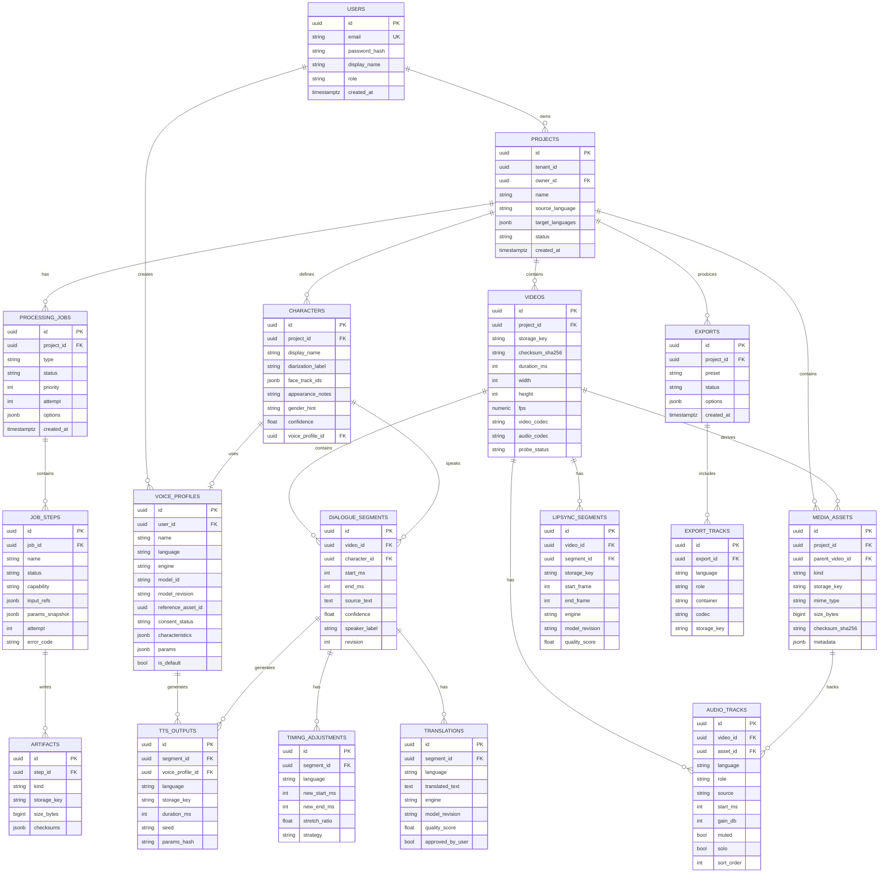

# CINEMA AI DUB — Database Design

**Phase:** Phase 1 — Project Architecture (documentation only)
**Status:** Proposed schema. No migration or database has been created.

---

## 1. Design principles

1. **PostgreSQL is the source of truth.** Redis holds queues, leases and transient progress only.
2. ** ids are UUIDv7 or UUIDv4** — opaque, safe to expose in URLs.
3. **Media is referenced by storage key**, never by absolute path (portable across local disk and S3).
4. **Every AI output is versioned** with model ID, revision and parameters; regeneration never silently overwrites history.
5. **Durable jobs and steps** enable restart recovery and auditability.
6. **Soft delete first, purge later** via a scheduled cleanup job.
7. **Tenant scoping** on every table via `tenant_id` where multi-tenant deployment is enabled.
8. **Times are `timestamptz`**, durations are integer milliseconds (`duration_ms`) to avoid float drift in editing.

---

## 2. Entity relationship diagram

---

## 3. Core tables (field detail)

### 3.1 `users`

| Column | Type | Notes |
|---|---|---|
| `id` | uuid PK | |
| `tenant_id` | uuid | Nullable for single-tenant installs; indexed. |
| `email` | citext UK | Case-insensitive. |
| `password_hash` | text | Argon2id; never plain text. |
| `display_name` | text | |
| `role` | enum `owner,admin,member,viewer` | Project authorization. |
| `is_active` | bool | |
| `created_at`, `last_login_at` | timestamptz | |

### 3.2 `projects`

| Column | Type | Notes |
|---|---|---|
| `id` | uuid PK | |
| `owner_id` | uuid FK → users | |
| `name`, `description` | text | |
| `source_language` | text | Default `en`. |
| `target_languages` | jsonb | e.g. `["ur","hi"]`. |
| `settings` | jsonb | Default mix gains, lip-sync on/off, export preset. |
| `status` | enum `draft,processing,ready,archived` | |
| `deleted_at` | timestamptz | Soft delete. |

### 3.3 `videos`

| Column | Type | Notes |
|---|---|---|
| `id`, `project_id` | uuid | |
| `storage_key` | text | Original immutable upload. |
| `checksum_sha256` | text | Dedupe/integrity. |
| `duration_ms` | int | Authoritative timeline length. |
| `width`, `height`, `fps` | int/numeric | From ffprobe. |
| `video_codec`, `audio_codec` | text | Stream-copy feasibility. |
| `color_space`, `bit_depth` | text | Quality preservation metadata. |
| `probe` | jsonb | Full ffprobe JSON. |

### 3.4 `media_assets`

`kind` enum: `source_video, dialogue_stem, music_stem, sfx_stem, reference_voice, external_audio, waveform_peaks, thumbnail, translated_tts, lipsync_fragment, mix, export`.

### 3.5 `audio_tracks`

| Column | Notes |
|---|---|
| `role` | `original_dialogue, dialogue_dub, music, sfx, external, master` |
| `language` | `en, ur, hi, null` |
| `source` | `extracted, generated, imported` |
| `gain_db`, `pan`, `muted`, `solo` | Mix state. |
| `start_ms`, `duration_ms` | Placement on timeline. |

### 3.6 `characters`

| Column | Notes |
|---|---|
| `diarization_label` | e.g. `SPEAKER_00`, user-remappable. |
| `face_track_ids` | jsonb list of visual track IDs from face detection. |
| `voice_profile_id` | FK; one active profile, history kept in `voice_profiles`. |
| `appearance_notes`, `gender_hint` | Used for voice characteristic suggestions. |
| `confidence` | Fusion confidence for automatic assignment. |

### 3.7 `voice_profiles`

| Column | Notes |
|---|---|
| `engine`, `model_id`, `model_revision` | Reproducibility. |
| `reference_asset_id` | User-supplied sample for cloning (consent required). |
| `consent_status` | `none, pending, granted, revoked`. |
| `characteristics` | jsonb: `deep, heavy, soft, male, female`, pitch/rate/style scalars. |
| `params` | jsonb: temperature, seed, speed, language hints. |
| `embedding_key` | Optional cached speaker embedding artifact. |

### 3.8 `dialogue_segments`

| Column | Notes |
|---|---|
| `start_ms`, `end_ms` | Original timing. |
| `source_text` | ASR output, user-correctable. |
| `speaker_label` | Raw diarization label. |
| `character_id` | Resolved character, nullable until confirmed. |
| `confidence`, `revision` | Audit and optimistic locking. |

### 3.9 `translations`

One row per `(segment, language)`; stores `translated_text`, `engine`, `model_revision`, `quality_score`, `approved_by_user`, `translator_notes`.

### 3.10 `tts_outputs`

One row per generated segment take: `voice_profile_id`, `language`, `storage_key`, `duration_ms`, `seed`, `params_hash`. Multiple takes are retained so the user can choose.

### 3.11 `timing_adjustments`

 Stores per-language timing repairs: `new_start_ms`, `new_end_ms`, `stretch_ratio`, `strategy` (`pause_insert`, `time_stretch`, `text_shortening`, `manual`).

### 3.12 `lipsync_segments`

Modified video fragments keyed by frame range; `quality_score` gates acceptance; engine and model revision recorded.

### 3.13 `processing_jobs`, `job_steps`, `artifacts`

- `processing_jobs.type`: `probe, demix, asr, diarize, translate, tts, lipsync, mix, export, import_audio`.
- `job_steps.name`: concrete step (e.g. `demucs_split`, `whisper_transcribe`).
- `job_steps.params_snapshot`: model ID, revision, seed, all parameters — frozen at creation.
- `artifacts`: every produced file with checksum; enables cleanup and verification.

### 3.14 `exports`, `export_tracks`

- `preset`: `original_only, urdu_dub, hindi_dub, all_tracks, audio_only`.
- `export_tracks`: one row per language/role deliverable with codec and storage key.

---

## 4. Indexes and constraints

| Table | Index / constraint | Purpose |
|---|---|---|
| `projects` | `(owner_id, deleted_at)` | Fast project lists. |
| `videos` | `(project_id)`, `checksum_sha256` | Lookup and dedupe. |
| `dialogue_segments` | `(video_id, start_ms)` | Timeline queries. |
| `translations` | UNIQUE `(segment_id, language)` | One approved translation per segment/language. |
| `tts_outputs` | `(segment_id, language, params_hash)` | Take lookup. |
| `job_steps` | `(job_id, name)`, `(status, capability)` | Resume and dispatch. |
| `audio_tracks` | `(video_id, sort_order)` | Mix ordering. |
| all media tables | FK + `ON DELETE RESTRICT` | Prevent accidental data loss. |

Row-level security (RLS): users can access only projects they own or are explicitly shared with.

---

## 5. Migrations and retention

- Migrations are forward-only, versioned, and reviewed before execution.
- Schema version stored in a `schema_migrations` table.
- `deleted_at` rows purged after a configurable retention window; artifacts removed only after the purge job verifies no references.
- Model cache and shared artifacts are outside the database and outside project deletion scopes.

---

## 6. What is deliberately not in the schema yet

- Billing/subscription tables (no paid dependency is planned).
- Collaboration comments and review approvals (possible later phase; not required now).
- Full subtitle style presets beyond basic text styling.

These omissions are architectural choices for Phase 1, not oversights.
