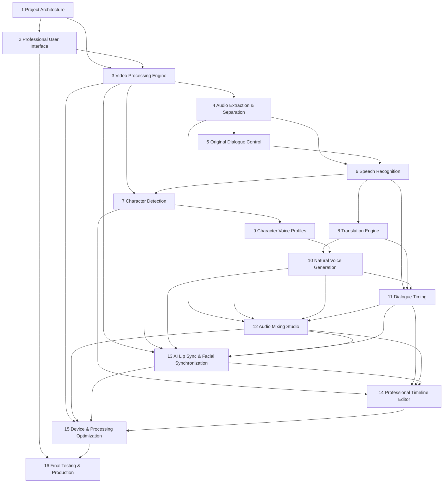

# CINEMA AI DUB — Phase Roadmap

**Status:** Phase 2 UI, Phase 3 video engine, Phase 4 audio extraction/separation, Phase 5 original dialogue control, Phase 6 speech recognition and Phase 7 character detection implemented; Phases 8–16 still planned
**Last updated:** 2026-11-26
**Correction:** This roadmap now uses the master 16 phases supplied by the user. No phase was added, removed, renamed or reordered. Useful architecture decisions from the earlier provisional roadmap (dependency logic, gates, rationale, verification gates) are preserved below.

---

## 0. Master 16 phases — exact order

| # | Phase (exact title) |
|---|---|
| 1 | Project Architecture |
| 2 | Professional User Interface |
| 3 | Video Processing Engine |
| 4 | Audio Extraction & Separation |
| 5 | Original Dialogue Control |
| 6 | Speech Recognition |
| 7 | Character Detection |
| 8 | Translation Engine |
| 9 | Character Voice Profiles |
| 10 | Natural Voice Generation |
| 11 | Dialogue Timing |
| 12 | Audio Mixing Studio |
| 13 | AI Lip Sync & Facial Synchronization |
| 14 | Professional Timeline Editor |
| 15 | Device & Processing Optimization |
| 16 | Final Testing & Production |

This list is the authoritative master plan. All other architecture documents must reference these phase numbers and titles.

---

## 1. Status of Phase 1

| Item | Status |
|---|---|
| System architecture | Documented |
| Frontend / backend / central AI design | Documented |
| Database, storage, queue, worker design | Documented |
| Full upload-to-export pipeline design | Documented |
| Local development vs cloud processing options | Documented in `TECHNOLOGY_STACK.md` §5 |
| Cost exposure of cloud GPU / storage / bandwidth | Documented in `TECHNOLOGY_STACK.md` §6 |
| All 25 required architecture areas | Covered (see mapping in `SYSTEM_ARCHITECTURE.md` §8) |
| Required Mermaid diagrams | Included across the seven documents |
| Implementation / UI / model integration | Phase 2 UI, Phase 3 engine, Phase 4 audio pipeline, Phase 5 dialogue/mixer control, Phase 6 speech recognition and Phase 7 character detection implemented; Phases 8–16 AI model integration not started |

---

## 2. Mandatory requirements mapped to phases

| Requirement | Where it is satisfied |
|---|---|
| **Phase 13 includes AI Lip Sync** | Phase 13 is explicitly **AI Lip Sync & Facial Synchronization**. Design: `AI_PIPELINE.md` §12. |
| **Phase 14 includes external audio import, character assignment and timeline editing** | Explicit in Phase 14 scope below. Designs: `AI_PIPELINE.md` §14, §15. |
| Original English, Urdu Dub and Hindi Dub audio tracks | Phase 12 (per-language masters) and Phase 16 (final multi-track package). Design: `AI_PIPELINE.md` §13. |
| Separate language exports as fallback | Phase 16 scope; design: `AI_PIPELINE.md` §13 (per-language MP4/WAV always produced in addition to the multi-track master). |
| Preserve original video quality | Phase 3 (probe/stream-copy policy) and Phase 13 (re-encode only lip-synced spans). Design: `AI_PIPELINE.md` §3. |
| Browser access on laptop, mobile and tablet | Phase 2 (responsive UI) and Phase 15 (device optimization). Design: `SYSTEM_ARCHITECTURE.md` §2, `AI_PIPELINE.md` §18. |
| Open-source models where possible | Phase 3–13 model choices; license register. Design: `TECHNOLOGY_STACK.md` §1–4. |
| No paid AI APIs without explicit user approval | Global constraint, `TECHNOLOGY_STACK.md` §1, §4, §6, §8. |
| Cloud GPU, storage and bandwidth may still cost money | `TECHNOLOGY_STACK.md` §5–6; must be acknowledged before any cloud deployment. |
| Local development and cloud processing kept separate | `TECHNOLOGY_STACK.md` §5 — two explicit deployment options, no code-level coupling. |

---

## 3. Phase scope and dependencies

| # | Phase | Scope | Depends on |
|---|---|---|---|
| 1 | Project Architecture | Approve this document set, freeze stack and license posture, confirm local/cloud options | — |
| 2 | Professional User Interface | Responsive browser shell for laptop/tablet/mobile, upload and review screens, project navigation | 1 |
| 3 | Video Processing Engine | Resumable upload, probe, thumbnails, frame/fps map, versioned artifacts, stream-copy policy | 1, 2 |
| 4 | Audio Extraction & Separation | PCM extraction, dialogue/music/SFX stems, separation quality gates, mute fallback | 3 |
| 5 | Original Dialogue Control | User-controlled mute/attenuation of original dialogue, per-stem gain/solo, preserve music/SFX | 4 |
| 6 | Speech Recognition | English transcription, word timings, confidence flags, user corrections and revisions | 4, 5 |
| 7 | Character Detection | Speaker diarization, face detection/tracking, fusion into characters, naming and review | 3, 6 |
| 8 | Translation Engine | English → Urdu and Hindi local translation, glossary, review/approval per segment | 6 |
| 9 | Character Voice Profiles | Per-character profile, deep/heavy/soft/male/female controls, consented reference audio | 7 |
| 10 | Natural Voice Generation | Per-segment TTS takes, consistency calibration, loudness normalization, take selection | 8, 9 |
| 11 | Dialogue Timing | Time-fit translated dialogue, pauses/bounded stretch/manual boundaries, overlap rules | 6, 8, 10 |
| 12 | Audio Mixing Studio | Original English, Urdu Dub and Hindi Dub masters; music/SFX/external bed; loudness QC | 4, 5, 10, 11 |
| 13 | AI Lip Sync & Facial Synchronization | **AI Lip Sync** for on-screen speech spans, quality gates, original-frame fallback, frame reintegration | 3, 7, 10, 11, 12 |
| 14 | Professional Timeline Editor | Multitrack timeline editing plus **external audio import** plus **character assignment** of imported audio | 7, 11, 12, 13 |
| 15 | Device & Processing Optimization | GPU lease/scheduler tuning, CPU fallback, mobile/tablet performance, cost-aware queueing, model caching | 3, 12, 13, 14 |
| 16 | Final Testing & Production | End-to-end QC, multi-track export, **separate language exports as fallback**, security/license review, release | 2–15 |

**Phase 13 note:** AI Lip Sync is a mandatory part of Phase 13, not an optional extra. It may be skipped *per project/character at runtime* when quality gates fail, with a clear warning and original-picture fallback, but the capability itself belongs to Phase 13.

**Phase 14 note:** External audio import, assigning imported audio to a character, and multitrack timeline editing are all mandatory parts of Phase 14.

---

## 4. Phase dependency diagram

Legend: arrows mean "must be usable before". Lip-sync output can be disabled per project at runtime, but Phase 14 and Phase 15 still depend on the Phase 13 capability being available.

---

## 5. Dependency rationale

1. **Architecture first:** all deployment, licensing and cost decisions are frozen in Phase 1 before any implementation.
2. **UI before engine:** the professional interface defines how uploads, review steps and previews are consumed; the engine then implements against that contract.
3. **Storage before AI:** every AI stage consumes and produces versioned artifacts; a stable storage abstraction is required from Phase 3 onward.
4. **Separation before ASR and dialogue control:** transcription and mute decisions depend on stems and the original audio.
5. **Diarization + vision before voice assignment:** a character identity must exist before a voice profile can be attached (Phase 7 → 9).
6. **Translation before TTS and timing:** target text length drives timing repair and speech generation (Phase 8 → 10, 11).
7. **Mixing before lip-sync:** lip-sync consumes final dialogue audio; regenerating it after mix changes wastes GPU time (Phase 12 → 13).
8. **Timeline after core pipeline:** the editor manipulates artifacts the pipeline already produces (Phase 14).
9. **Optimization after a full pipeline exists:** GPU scheduling, CPU fallback and mobile tuning need realistic end-to-end flows to measure (Phase 15).
10. **Testing/production last:** release QC, separate language exports and security/license review require all prior phases (Phase 16).

---

## 6. Gates between phases

| From → To | Gate |
|---|---|
| 1 → 2 | Architecture docs approved; exact 16 phases confirmed; license and cost posture acknowledged. |
| 2 → 3 | Responsive UI shell verified on laptop, tablet and mobile browsers. |
| 3 → 4 | Probe, frame map and stream-copy policy verified on a sample video. |
| 4 → 5 | Stems validated; separation quality gates and mute fallback confirmed. |
| 5 → 6 | Original dialogue can be muted/attenuated without losing music/SFX. |
| 6 → 7 | Word timings and corrections stored/revisioned. |
| 7 → 8 | Characters reviewed, named and linked to speaker turns. |
| 8 → 9 | Urdu/Hindi text approved per segment. |
| 9 → 10 | Sample voice per character accepted; consent recorded for references. |
| 10 → 11 | Generated speech durations fit with no drift. |
| 11 → 12 | Dialogue boundaries and overlap rules verified. |
| 12 → 13 | Original English, Urdu Dub and Hindi Dub masters render and pass loudness QC. |
| 13 → 14 | AI Lip Sync sample passes quality gates (or is explicitly disabled with warning). |
| 14 → 15 | External audio import, character assignment and timeline edits reproduce deterministic mixes. |
| 15 → 16 | Device targets and cost-aware processing options measured/documented. |

---

## 7. Cost and deployment position (cross-reference)

- **Local development** and **cloud processing** are separate options; neither is hardcoded into the architecture. See `TECHNOLOGY_STACK.md` §5.
- **No paid AI API** may be used without explicit user approval. Open-source/self-hosted models are the default.
- **Cloud GPU, object storage and outbound bandwidth may still cost money** even when all models are open-source. This is a deployment cost, not an AI API fee. See `TECHNOLOGY_STACK.md` §6.
- These costs are not incurred by Phase 1 documentation and require a separate approval before any cloud deployment.

---

## 8. Decisions requiring approval before Phase 2

1. Confirm that the exact 16 phases and order in §0 are final.
2. Confirm that the empty target folder is the intended project root (assumption A1).
3. Confirm target hardware for local development: single RTX 3050 8 GB-class machine vs larger GPU server (A5).
4. Confirm English → Urdu + Hindi is the complete launch language set (A3).
5. Confirm that "no paid AI APIs" also prohibits free-tier cloud API keys unless explicitly approved.
6. Acknowledge that cloud GPU, storage and bandwidth may cost money (§7).
7. Confirm quality-preservation policy: stream-copy untouched video, re-encode only lip-synced spans (A6).
8. Confirm voice cloning consent model and whether built-in cloning is allowed at all (A10).
9. Confirm export deliverables: multi-track MP4 with Original English, Urdu Dub and Hindi Dub plus separate per-language files as fallback.
10. Confirm export container/audio codec requirements and browser playback expectations (A9).
11. Confirm licensing posture for commercial use (excludes NLLB, XTTS weights and non-commercial Piper voices from defaults).
12. Confirm storage location, retention and quota policy for uploads and exports.

---

## 9. Confirmation

The exact 16 phases and their order remain authoritative. Phase 2 (Professional User Interface), Phase 3 (Video Processing Engine), Phase 4 (Audio Extraction & Separation), Phase 5 (Original Dialogue Control), Phase 6 (Speech Recognition) and Phase 7 (Character Detection) are implemented in this codebase. Phases 8–16 are not started. The Phase 6 local engine uses open-source faster-whisper/CTranslate2 models on CPU; Phase 7 uses Silero VAD, SpeechBrain ECAPA-TDNN and scikit-learn clustering on CPU. Later AI stages remain blocked on the approvals above and explicit model licensing confirmation.

---

## 10. Phase 4 implementation note

Phase 4 ships a CPU-feasible built-in spectral/envelope estimator, with optional Demucs and remote processing adapters selected through `SEPARATION_BACKEND`. The built-in stems are explicitly labelled approximate: dialogue is a band-limited estimate, music is a spectral estimate, and SFX/ambience are split by an RMS envelope heuristic; no stem is presented as validated clean speech. Extracted audio and stems are stored as separate versioned assets while the uploaded video remains byte-for-byte untouched. Demucs is optional, uses MIT-licensed code and MIT/CC-BY-NC-SA model weights depending on the selected model; the remote adapter is optional and requires a separately configured service. No browser GPU is required.

---

## 11. Phase 5 implementation note

Phase 5 adds a per-project audio mixer over the Phase 4 stems: volume, mute, solo and enable controls for original dialogue, music, SFX and ambience, plus disabled placeholders for future Urdu and Hindi dub tracks. Mix preview plays the available stems against the original video and aligns them on play, pause, seek and playback-rate changes. Settings are stored in `audio_mixer_settings` and restored when the project is reopened. Dialogue removal acts on the separated dialogue stem only; because the built-in stem is not validated clean speech, the UI warns that leakage may remain. The uploaded video and extracted source audio are never modified.

---

## 12. Phase 7 implementation note

Phase 7 adds local, open-source speaker diarization and reviewable character identities. The default CPU stack is Silero VAD (MIT) for speech start/stop, SpeechBrain ECAPA-TDNN `speechbrain/spkrec-ecapa-voxceleb` (Apache-2.0) for voice embeddings, and scikit-learn agglomerative clustering (BSD-3-Clause) for stable speaker groups. Audio is decoded with ffmpeg rather than torchaudio I/O so the stack works with recent torchaudio builds that require torchcodec. No Hugging Face token or paid API is required for the default path. pyannote.audio and WhisperX diarization were evaluated but are not the default because their gated models require Hugging Face account acceptance and a read token.

Speaker turns, voice embeddings, transcript-segment assignments, visible-person candidates and approximate face tracks are persisted in project-scoped tables (`characters`, `speaker_turns`, `visual_candidates`, `face_tracks`, `character_assignments`). A character ID is stable across scenes when voice embeddings match above the configured threshold with a sufficient margin; close or ambiguous matches are marked for review rather than silently merged. Manual rename, merge, split, segment reassignment and visual-candidate confirmation are preserved across re-detection and re-transcription.

Visual association samples sparse frames around dialogue and uses OpenCV Haar cascades only to propose *visible-person candidates*. It is not face recognition, does not claim real-world identity, and never assumes a visible person is the speaker; off-screen and voice-over speakers legitimately have zero candidates. All speaker-to-visible-person links require explicit human confirmation. Overlapping speech is approximated by flagging low-margin clusters for review rather than separating simultaneous transcripts; true multi-talker speech separation remains a later-phase capability. Optional remote/GPU backends exist only when explicitly configured with a URL; no free cloud GPU is assumed.
