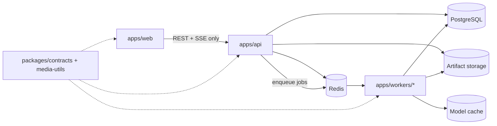

# CINEMA AI DUB — Recommended Project Structure

**Phase:** Phase 1 — Project Architecture (documentation only)
**Status:** Proposed layout. Only the `docs/architecture/` folder exists today; no application folders have been created.

---

## 1. Layout principles

1. **Monorepo, separate deployables:** web client, API control plane and workers are independently runnable.
2. **Thin client, thick server:** no AI/inference packages under `apps/web`.
3. **Capability-based workers:** each heavy model family lives in its own worker module so dependencies and GPU leases stay isolated.
4. **Shared contracts:** request/response and event types live in one package used by API and workers.
5. **Migrations and infra are versioned** next to code.
6. **Generated artifacts, model weights and uploads are never committed.**
7. **Architecture docs live in `docs/architecture/`** and remain the source of truth for Phase 1.

---

## 2. Proposed repository tree

```text
cinema-ai-dub/
├─ README.md
├─ AGENTS.md                         # contributor/agent rules (future)
├─ docker-compose.yml                # local dev: db, redis, api, workers, web
├─ .env.example                      # documented variables, no secrets
├─ .gitignore                        # artifacts, models, caches, secrets
│
├─ apps/
│  ├─ web/                           # browser client (Next.js + React + TS)
│  │  ├─ src/
│  │  │  ├─ app/                     # routes: dashboard, project, editor, exports
│  │  │  ├─ components/
│  │  │  │  ├─ studio/               # upload, review, character, translation steps
│  │  │  │  ├─ timeline/             # multitrack editor (future phase)
│  │  │  │  ├─ preview/              # media players, waveform canvas
│  │  │  │  └─ ui/                   # shared responsive primitives
│  │  │  ├─ hooks/                   # API queries, SSE progress, polling fallback
│  │  │  ├─ lib/
│  │  │  │  ├─ api-client.ts
│  │  │  │  ├─ format.ts             # timecode/duration formatting
│  │  │  │  └─ feature-flags.ts
│  │  │  └─ styles/
│  │  ├─ public/fonts/               # cleared fonts incl. Urdu/Hindi shaping
│  │  └─ tests/                      # unit + browser tests
│  │
│  ├─ api/                           # FastAPI control plane (stateless)
│  │  ├─ app/
│  │  │  ├─ main.py                  # app wiring, health, routers
│  │  │  ├─ config.py                # environment validation
│  │  │  ├─ deps.py                  # auth, db, storage dependencies
│  │  │  ├─ routers/
│  │  │  │  ├─ auth.py
│  │  │  │  ├─ projects.py
│  │  │  │  ├─ uploads.py
│  │  │  │  ├─ videos.py
│  │  │  │  ├─ jobs.py
│  │  │  │  ├─ characters.py
│  │  │  │  ├─ voices.py
│  │  │  │  ├─ segments.py
│  │  │  │  ├─ timeline.py
│  │  │  │  └─ exports.py
│  │  │  ├─ services/
│  │  │  │  ├─ auth_service.py
│  │  │  │  ├─ project_service.py
│  │  │  │  ├─ media_service.py
│  │  │  │  ├─ job_service.py
│  │  │  │  ├─ character_service.py
│  │  │  │  ├─ timeline_service.py
│  │  │  │  └─ export_service.py
│  │  │  ├─ repositories/            # SQL queries per aggregate
│  │  │  ├─ schemas/                 # Pydantic request/response models
│  │  │  ├─ events.py                # SSE fan-out from Redis
│  │  │  └─ security/                # tokens, signed URLs, quota checks
│  │  ├─ migrations/                 # Alembic versions
│  │  └─ tests/                      # API + service tests
│  │
│  └─ workers/                       # central AI processing tier
│     ├─ common/
│     │  ├─ celery_app.py            # queues, routing, retries
│     │  ├─ gpu_lease.py             # exclusive device lease + heartbeat
│     │  ├─ storage.py               # artifact paths, checksums, signed refs
│     │  ├─ model_cache.py           # pinned model IDs/revisions, load/unload
│     │  ├─ quality_gates.py         # shared validation helpers
│     │  ├─ events.py                # progress/heartbeat emitters
│     │  └─ errors.py                # error codes, retry policy
│     ├─ media/                      # probe, extract, stream-copy, mux, QC
│     │  ├─ ffprobe.py
│     │  ├─ ffmpeg_tasks.py
│     │  └─ qc.py
│     ├─ separation/                 # dialogue/music/SFX stems
│     ├─ asr/                        # transcription + word timings
│     ├─ diarization/                # speaker turns
│     ├─ vision/                     # face detect/track, appearance clustering
│     ├─ translation/                # EN→UR/HI local engines + glossary
│     ├─ tts/                        # voice profiles, take generation, calibration
│     ├─ lipsync/                    # span generation + frame reintegration
│     ├─ mixing/                     # mix graph renderer, loudness, stems
│     └─ export/                     # packaging, per-language tracks, reports
│
├─ packages/
│  ├─ contracts/                     # shared enums, DTOs, event schemas
│  └─ media-utils/                   # timecode, frame math, duration helpers
│
├─ infra/
│  ├─ docker/                        # Dockerfiles per deployable
│  ├─ nginx or caddy/                # TLS, upload limits, signed URL proxying
│  ├─ monitoring/                    # dashboards/alerts (optional)
│  └─ scripts/                       # model prefetch, backup, cleanup, dev setup
│
├─ docs/
│  ├─ architecture/                  # Phase 1 deliverables (this folder)
│  │  ├─ SYSTEM_ARCHITECTURE.md
│  │  ├─ DATABASE_DESIGN.md
│  │  ├─ AI_PIPELINE.md
│  │  ├─ API_DESIGN.md
│  │  ├─ TECHNOLOGY_STACK.md
│  │  ├─ PROJECT_STRUCTURE.md
│  │  └─ PHASE_ROADMAP.md
│  ├─ operations/                    # runbooks (future)
│  └─ THIRD_PARTY_LICENSES.md        # model/checkpoint license register (future)
│
└─ tests/
   ├─ e2e/                           # full pipeline fixtures (future)
   └─ fixtures/                      # tiny sample media, no copyrighted content
```

---

## 3. External runtime directories (outside the repository)

```text
CINEMA_DATA_DIR/
├─ artifacts/
│  └─ tenants/<tenant_id>/projects/<project_id>/{source,stems,asr,voices,tts,lipsync,mixes,exports,temp}
├─ model-cache/                      # persistent; NEVER inside a disposable volume
│  ├─ asr/
│  ├─ separation/
│  ├─ translation/
│  ├─ tts/
│  └─ lipsync/
├─ database/                         # PostgreSQL data volume
├─ redis/                            # Redis data volume
└─ logs/
```

Rules:

- `CINEMA_DATA_DIR` is configurable via environment variable; default local path documented in `.env.example`.
- Model cache is created explicitly and mounted with stable names. Cleanup jobs must never target it.
- Artifact keys are relative (`tenants/.../file.wav`), resolved through the storage abstraction.
- Backups cover PostgreSQL + artifact metadata; model cache can be re-downloaded.

---

## 4. Module dependency rules



Prohibited dependencies:

- `apps/web` → any model/inference library, database client or filesystem path.
- `apps/api` → model weights or GPU-only libraries.
- Workers → direct HTTP endpoints of the API (they communicate through queue + DB state).
- Any module → hardcoded storage paths or secrets.

---

## 5. Naming conventions (proposed)

| Item | Convention | Example |
|---|---|---|
| API routes | kebab-case plural nouns | `/voice-profiles` |
| DB tables | snake_case plural | `dialogue_segments` |
| Job step names | lowercase verb/noun | `demucs_split` |
| Storage keys | lowercase, slash-separated, content-prefixed | `tenants/t1/projects/p1/tts/ab12cd.wav` |
| Event names | dot-separated | `step.progress`, `export.ready` |
| Error codes | SCREAMING_SNAKE_CASE | `LIPSYNC_FRAME_MISMATCH` |
| Worker modules | one capability per directory | `workers/asr/` |

---

## 6. What this structure deliberately postpones

- Actual files in `apps/`, `workers/` and `infra/` — Phase 2+ only.
- Specific model checkpoint folders under `model-cache/` — decided during implementation from the approved stack.
- Collaboration/comments, billing, plugin system and mobile native wrappers.
