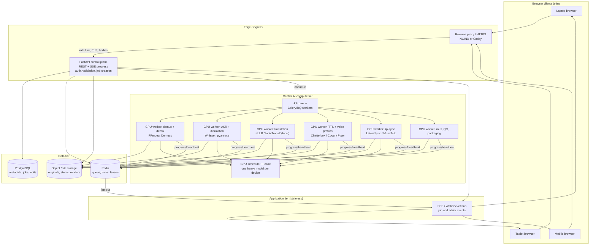
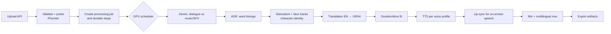
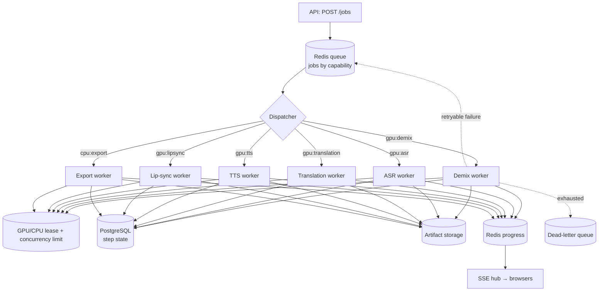

# CINEMA AI DUB — System Architecture

**Phase:** Phase 1 — Project Architecture (documentation only)
**Status:** Proposed. No implementation, UI, or model integration has been started.
**Last updated:** 2026-11-23

---

## 0. Scope, evidence and assumptions

This section exists because the instructions require that no assumption be made without documenting it.

### 0.1 What was actually inspected

| Item | Finding |
|---|---|
| Target project folder `C:\Users\ayaan\Desktop\video studio ai` | **Empty at inspection** — no files, no hidden files, no git metadata, no `package.json`, no source code. A git repository with no commits was present later in the session (not created by this documentation work); only `docs/` is currently untracked. |
| Adjacent folder `C:\Users\ayaan\Desktop\ai_video-gen` | A different, existing project: Next.js + FastAPI + Docker + local AI models for text-to-image/video, TTS and lip-sync. Inspected **as reference only**; nothing was copied, modified or deleted. |
| Desktop planning documents | `AI_Video_Studio_A_to_Z_Analysis.md` and MAHNOOR phase reports inspected. They describe other projects (AI Video Studio, MAHNOOR AI) and are **not** the source of the CINEMA AI DUB master plan. |
| Master 16-phase plan | Supplied by the user in the Phase 1 correction. Recorded verbatim, in exact order, in `PHASE_ROADMAP.md` §0. The earlier provisional slot list was replaced; no document was deleted. |

### 0.2 Documented assumptions (require confirmation)

| ID | Assumption | Why it matters | Confirm? |
|---|---|---|---|
| A1 | CINEMA AI DUB starts as a new codebase in the empty target folder. | Determines project structure; no legacy code must be preserved there. | Yes |
| A2 | All AI processing runs **centrally on the server**, never on the client. Clients are thin browsers (laptop, tablet, mobile). | Drives GPU scheduling, upload design and security. | Yes (explicit requirement) |
| A3 | Source language is English; target languages are Urdu and Hindi at launch. | Drives translation, TTS and track model. | Yes (explicit requirement) |
| A4 | Open-source, self-hostable components are the default. No paid AI API may be used without explicit user approval. Local development and cloud processing remain separate deployment options; cloud GPU/storage/bandwidth may still cost money. | Drives technology selection and cost disclosure. | Yes (explicit requirement) |
| A5 | Reference hardware for cost/sizing is a single machine with an NVIDIA GPU (the adjacent reference project uses an RTX 3050 8 GB, 32 GB RAM, Windows + Docker/WSL2). The architecture must also work on a larger multi-GPU server. | Determines concurrency limits and model choices. | Yes |
| A6 | Original video is preserved by stream-copy wherever no visual edit is needed; only lip-synced spans are re-encoded. | "Preserve original quality wherever technically possible." | Yes |
| A7 | Uploads are untrusted input; projects are private to their owner by default. | Security and file-access design. | Yes |
| A8 | The master 16-phase plan supplied by the user is authoritative; phase numbers and order must not change. | Roadmap integrity. | Confirmed — see `PHASE_ROADMAP.md` §0 |
| A9 | Local playback of exported files uses standard browser-supported H.264/AAC MP4 plus separate audio track files; advanced multi-track playback in the browser is a later capability, not a Phase 1 promise. | Multilingual track architecture. | Yes |
| A10 | Voice cloning is opt-in and only from user-owned reference audio; no real-person impersonation without consent. | Legal/ethical safety. | Yes |

### 0.3 Non-goals for Phase 1

- No application code, UI, API server, schema migration or model download.
- No Phase 2 work (e.g. first working vertical slice) until this document set is approved.
- No selection of commercial APIs without explicit user approval; no paid subscription dependency in the default design.

---

## 1. Overall system architecture

CINEMA AI DUB is a **browser-first, server-computed dubbing studio**. The browser handles upload, review, annotation, multitrack editing and export triggering. Every expensive or model-based operation (demixing, ASR, diarization, translation, TTS, lip-sync, muxing) happens in a central server-side worker fleet. Artifacts live on server storage and are addressed by opaque IDs and short-lived signed URLs.



### 1.1 Communication rules

| Path | Protocol | Notes |
|---|---|---|
| Browser → API | HTTPS REST (JSON) + multipart upload | Chunked/resumable upload for large videos. |
| Browser → progress | SSE (preferred) or WebSocket | Job state, stage progress, ETA, warnings. Mobile-safe fallback to polling. |
| API → DB | SQL over private network | All business state is durable in PostgreSQL; Redis is never the source of truth. |
| API → workers | Queue messages via Redis | Idempotent job/step IDs; no direct HTTP between API and model services required. |
| Workers → storage | Shared volume or S3-compatible API | Workers pass **paths/keys**, never raw media bytes. |
| Workers → API | Status events through Redis/cache | API remains stateless and restartable. |

### 1.2 Why central processing

1. Model weights are large (multi-GB); duplicating them on clients is impractical, especially on mobile.
2. Reproducibility: the same server-side pipeline yields the same dub for every device.
3. Access control: media never has to be downloaded to a client for processing.
4. GPU pooling and serialization: one expensive model at a time per device avoids OOM.
5. Browsers only need to render UI and play preview media.

---

## 2. Frontend architecture (design target only)

- **Framework:** Next.js + React + TypeScript (consistent with the technologies already present in the reference project), Tailwind CSS for responsive styling.
- **Rendering:** server-rendered shell, client components for the workspace; no AI code in the browser.
- **Responsive layout:** three breakpoints — desktop (full multitrack timeline + preview), tablet (collapsed track lanes + preview), mobile (guided wizard + simplified segment list, timeline read-only).
- **State:** server state via typed API hooks; local editor state in a normalized store; optimistic edits with server reconciliation.
- **Media preview:** HTML5 video/audio with object URLs from signed endpoints; waveform peaks fetched as small JSON, never full audio, on mobile.
- **Accessibility:** keyboard-editable segment table as alternative to drag-and-drop timeline; captions/subtitles visible.
- **Offline tolerance:** queued edits retried; progress via SSE with polling fallback on unstable mobile networks.

No UI code is part of Phase 1.

---

## 3. Backend architecture (design target only)

- **Control plane (FastAPI):** authentication, project CRUD, upload orchestration, job creation, authorization, signed URLs, editor state, export requests.
- **Domain services:** project service, media service, job service, character service, voice-profile service, timeline service, export service. Each service owns its own transactions.
- **Data layer:** PostgreSQL with SQL migrations (Alembic-style); Redis for queue, short-lived leases and progress counters.
- **Worker layer:** separate processes/containers grouped by GPU capability; each worker registers capabilities (e.g. `asr`, `tts`, `lipsync`) and pulls only matching tasks.
- **Storage layer:** object/file abstraction (`StorageBackend` interface) so local disk during development and S3-compatible storage in production use the same API.
- **Observability:** structured logs with `job_id`/`step_id`, per-step metrics, health endpoints, dead-letter queue.

---

## 4. Central AI processing architecture



Design rules:

- **Every AI step is a separate, retryable job step** with its own inputs, outputs and version pins (model ID + revision + parameters).
- **GPU lease:** a scheduler grants one exclusive lease per GPU device; workers load/unload models under the lease and release it in `finally` blocks. This directly addresses the OOM problem observed in the reference project where independent containers competed for one GPU.
- **Determinism:** seed, model revision, and parameter snapshot stored per step; re-running a step reproduces the same output.
- **Human checkpoints:** after diarization, after translation and after timing fit — the user can correct assignments before expensive TTS/lip-sync runs.
- **Degradation paths:** if a heavy lip-sync model fails, dub audio can still be exported with a clear warning; if demixing is poor, the user can choose mute-only dialogue removal.

---

## 5. Database architecture (summary)

See `DATABASE_DESIGN.md` for full tables and the ER diagram. Core entities: `users`, `projects`, `videos`, `media_assets`, `audio_tracks`, `characters`, `voice_profiles`, `dialogue_segments`, `translations`, `processing_jobs`, `job_steps`, `exports`, `editor_events`.

Key rules:

- All media rows reference storage keys, never absolute filesystem paths.
- All AI outputs are versioned and linked to the source segment + model revision.
- Jobs and steps are durable; restarts resume from the last completed step.
- Soft delete for user-visible assets; physical deletion runs as a scheduled cleanup job.

---

## 6. File storage architecture (summary)

```
storage/
  tenants/<tenant_id>/
    projects/<project_id>/
      source/            original upload (immutable, checksummed)
      probes/            ffprobe JSON, thumbnails, keyframes
      stems/             dialogue, music, sfx (demux/demix outputs)
      asr/               transcripts, word timings
      voices/            user reference audio (consent recorded)
      tts/               per-segment generated speech (UR, HI)
      lipsync/           modified video fragments
      mixes/             per-language mixes
      exports/           final deliverables
      temp/              scratch, TTL-cleaned
```

- Content-addressed names (SHA-256 prefix) prevent accidental overwrites.
- Signed, short-lived URLs for browser access; no public directory listing.
- Originals are never modified; every transformation writes a new artifact.
- Quota accounting per user/project; retention policy configurable.
- Model weights stored **outside** this tree in a dedicated model cache volume; never deleted by project cleanup. This is a direct lesson from the reference project where `docker compose down -v` destroyed ~60 GB of models.

---

## 7. Background job queue and worker architecture



- **Queues** are separated by capability so CPU export work is not blocked by a GPU job.
- **Priority:** interactive preview jobs > normal jobs > bulk exports.
- **Lease timeout + heartbeat:** a crashed worker's step is requeued after the lease expires.
- **Idempotency:** every step writes to a deterministic output key; retries overwrite safely.
- **Cancellation:** cooperative — worker checks a cancel flag between frames/segments.
- **Dead-letter:** after N retries, the job is marked `failed` with a machine-readable reason and a human message.

---

## 8. Cross-cutting architecture map

The remaining 18 detailed areas are specified in `AI_PIPELINE.md`, `DATABASE_DESIGN.md`, `API_DESIGN.md` and `TECHNOLOGY_STACK.md`. The mapping below ensures full coverage of the Phase 1 brief.

| # | Required area | Primary document |
|---|---|---|
| 1 | Overall system architecture | This document |
| 2 | Frontend architecture | This document, §2 |
| 3 | Backend architecture | This document, §3 |
| 4 | Central AI processing architecture | This document, §4 |
| 5 | Database architecture | `DATABASE_DESIGN.md` |
| 6 | File storage architecture | This document, §6 |
| 7 | Background job queue and worker architecture | This document, §7 |
| 8 | Video processing pipeline | `AI_PIPELINE.md` §3 |
| 9 | Audio extraction and separation pipeline | `AI_PIPELINE.md` §4 |
| 10 | Speech recognition and transcription pipeline | `AI_PIPELINE.md` §5 |
| 11 | Speaker and character detection pipeline | `AI_PIPELINE.md` §6 |
| 12 | Translation pipeline | `AI_PIPELINE.md` §7 |
| 13 | Character voice profile architecture | `AI_PIPELINE.md` §8 |
| 14 | Natural voice generation pipeline | `AI_PIPELINE.md` §9 |
| 15 | Dialogue timing and synchronization architecture | `AI_PIPELINE.md` §10 |
| 16 | Audio mixing architecture | `AI_PIPELINE.md` §11 |
| 17 | AI Lip Sync architecture | `AI_PIPELINE.md` §12 |
| 18 | Multilingual audio track architecture | `AI_PIPELINE.md` §13 |
| 19 | Professional timeline editor architecture | `AI_PIPELINE.md` §14 |
| 20 | External audio import architecture | `AI_PIPELINE.md` §15 |
| 21 | Final video and audio export architecture | `AI_PIPELINE.md` §16 |
| 22 | Authentication and project management | `API_DESIGN.md` §2, `DATABASE_DESIGN.md` §3 |
| 23 | Error handling and job recovery | `API_DESIGN.md` §7, `AI_PIPELINE.md` §17 |
| 24 | Security and file access | `API_DESIGN.md` §8 |
| 25 | Mobile, tablet and laptop compatibility | This document §2, `AI_PIPELINE.md` §18 |

---

## 9. Important technical challenges (architecture-level)

1. **Single-GPU contention** — solved by central leases; see §4.
2. **Dialogue removal without damaging music/SFX** — demix quality varies; offer mute-only fallback and per-stem user control.
3. **Speaker ↔ face association** — audio diarization and visual face tracks must be fused by time overlap; confidence scores required.
4. **Translation length vs original timing** — Urdu/Hindi text is often longer; use script adaptation, gentle time-stretch and user-adjustable segment boundaries.
5. **Voice consistency** — one immutable voice profile per character, cached reference embeddings, deterministic seed.
6. **Lip-sync cost and quality** — only re-encode affected spans; keep original frames elsewhere; optional skip if quality gate fails.
7. **Quality preservation** — stream-copy video wherever no visual edit occurs.
8. **Large-file uploads on mobile** — resumable chunked upload and server-side probing.
9. **Right-to-left scripts** — Urdu text shaping, font and subtitle rendering must be tested from the start.
10. **Licensing** — avoid non-commercial voice samples; all bundled assets must permit the intended use.

---

## 10. Decisions requiring approval

See `PHASE_ROADMAP.md` §8. The exact 16 phases and order are recorded in `PHASE_ROADMAP.md` §0. Deployment cost exposure and the separation of local development from cloud processing are documented in `TECHNOLOGY_STACK.md` §5–6.
