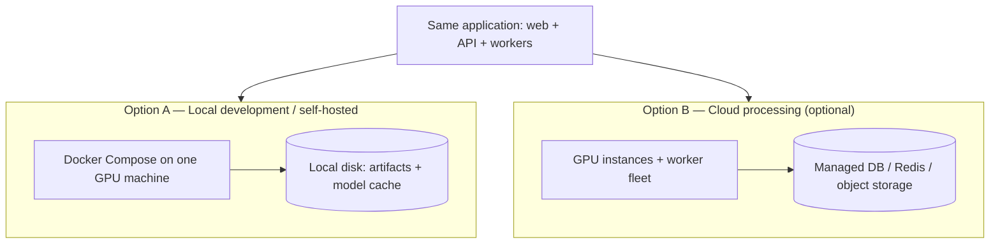

# CINEMA AI DUB — Technology Stack

**Phase:** Phase 1 — Project Architecture (documentation only)
**Status:** Recommended stack. No dependency has been installed and no model has been downloaded.

---

## 1. Selection rules

1. Free and open-source preferred; self-hostable; no required paid AI API. A paid AI API may be introduced only with explicit user approval.
2. License must permit the intended use. **Non-commercial-only models/weights are excluded from the default stack** and listed separately as warnings.
3. Components must run centrally on a server and be callable from a thin browser client.
4. Mature tooling with clear upgrade/error behavior wins over experimental models.
5. Something observed working in the adjacent reference project is noted as *reference evidence*, not as a dependency of this new project.

---

## 2. Recommended stack by layer

| Layer | Technology | Why | License / caveat |
|---|---|---|---|
| Frontend framework | **Next.js + React + TypeScript** | Familiar, strong responsive UI ecosystem; matches reference project experience. | Next.js MIT, React MIT. |
| Styling | **Tailwind CSS** | Fast responsive layouts for laptop/tablet/mobile. | MIT. |
| Frontend tests | Node test runner / Vitest / Playwright | Lightweight unit + browser checks. | MIT / Apache-2.0. |
| Backend API | **Python + FastAPI + Pydantic** | Excellent async API, strict validation, easy model integration. Reference project uses it successfully. | MIT. |
| Database | **PostgreSQL** | Relational integrity for jobs, edits and audit; JSONB for flexible metadata. | PostgreSQL License (permissive). |
| Migrations | **Alembic** | Versioned schema changes. | MIT. |
| Cache/queue | **Redis** | Mature queue and lease primitives. | Redis license (BSD-style core; check module licenses). |
| Task queue | **Celery** (or RQ for simpler start) | Retries, priorities, schedules, dead-letter patterns. | BSD / MIT. |
| Media processing | **FFmpeg / FFprobe** | Industry standard for extraction, stream copy, mixing, muxing and QC. | LGPL/GPL builds — choose build to match distribution model. |
| Object storage | **Local filesystem abstraction → S3-compatible (MinIO)** | Same interface from dev to production; no cloud lock-in. | MinIO AGPLv3 (check if embedding/serving affects obligations); local FS avoids it. |
| Reverse proxy | **Caddy** (or NGINX) | Automatic HTTPS, simple config; NGINX is a well-known alternative. | Apache-2.0 / BSD-2. |
| Containers | **Docker + Docker Compose**, optional Kubernetes later | Reproducible environments; GPU passthrough via NVIDIA Container Toolkit. | Docker Engine Apache-2.0 (some editions have other terms). |
| GPU model serving | **Python workers + PyTorch** | Direct control of load/unload and VRAM; no separate paid serving platform. | BSD-3-Clause (PyTorch); check CUDA redistributables. |
| Source separation | **Demucs** | Strong open music/speech separation; reference-quality stem extraction. | MIT code (verify weights terms). |
| ASR | **OpenAI Whisper** via faster-whisper / whisper.cpp | Word timestamps, multilingual, proven; local inference. | MIT (model + most implementations). |
| Diarization | **pyannote.audio** (or local alternative) | Speaker turn detection. | Code MIT; **pretrained models require accepting terms/token — verify before use**. |
| Face detection/tracking | **InsightFace / RetinaFace-based libraries**, OpenCV | Character face tracks on CPU/GPU. | Code MIT/Apache-2.0; model licenses vary — audit each. |
| Translation | **IndicTrans2** (MIT), **Qwen-class local LLM** (Apache-2.0) | Good Hindi/Urdu capability without paid API. | See §4 for NLLB warning. |
| TTS | **Chatterbox Multilingual** (reference project: working, MIT), **Kokoro-82M** (Apache-2.0), **Piper** (code MIT, voice-specific) | Local, no per-character API cost. | Voice/model licenses must be checked individually. |
| Lip-sync | **LatentSync 1.5** (Apache-2.0, reference default), **MuseTalk** (MIT, backup), **OmniAvatar** (Apache-2.0, experimental for non-human faces) | Proven locally in the reference project; deterministic and self-hosted. | Code licenses permissive; check checkpoint terms. |
| Audio QC | **loudnorm/ebur128 (FFmpeg), numpy/scipy** | Loudness and silence checks. | FFmpeg license caveat above; NumPy BSD-3. |
| Monitoring | **OpenTelemetry + Prometheus + Grafana** (optional) | Job metrics, GPU utilization, error rates. | Apache-2.0. |
| Auth | **Argon2id password hashing + JWT** | Standard, no paid identity service required. | Libraries MIT/BSD. |

---

## 3. Reference evidence (adjacent project, inspected only)

The adjacent `ai_video-gen` project demonstrates that several of these components work on the available hardware:

- Next.js 16.4.6 + React 19.3 + Tailwind 4 frontend.
- FastAPI backend with FFmpeg-based media handling and Docker Compose.
- Chatterbox Multilingual TTS running locally with voice cloning.
- LatentSync 1.5 + GFPGAN lip-sync, with measured sync improvement over MuseTalk.
- OmniAvatar for non-human characters, tested manually but not integrated into that app.
- Important operational lessons adopted into this architecture:
  - one GPU-heavy job at a time under a shared lease;
  - model weights stored outside disposable Docker volumes;
  - validate outputs (decode checks, frame-count checks) before exposing downloads;
  - avoid non-commercial voice samples in a product.

These are observations only; CINEMA AI DUB does not inherit or modify that codebase.

---

## 4. Licensing considerations and warnings

| Item | Status | Action |
|---|---|---|
| **NLLB-200** | Widely used for translation but distributed under **CC-BY-NC-4.0 (non-commercial)**. | **Not in the default stack.** Use IndicTrans2 (MIT) or an Apache-2.0 local LLM unless the product is strictly non-commercial and terms are accepted. |
| **Coqui XTTS v2 weights** | Commonly used for cloning; model license is **non-commercial** (CPML). | Avoid as default. Use Chatterbox (MIT) or Kokoro (Apache-2.0) instead. |
| **Piper voice models** | Code is permissive, but individual voices have their own licenses (reference project has a CC BY-NC-SA voice). | Audit every voice file; never bundle a non-commercial voice silently. |
| **pyannote pretrained models** | Access requires accepting user conditions; terms can restrict use. | Evaluate a permissive alternative or obtain explicit acceptance before shipping. |
| **FFmpeg build** | LGPL vs GPL depends on configured components. | Choose LGPL build for proprietary-friendly distribution, or comply with GPL if using GPL components. |
| **MinIO** | AGPLv3. | Acceptable for internal self-hosting; evaluate obligations before redistribution. Local filesystem backend avoids this. |
| **Model checkpoints generally** | Code license ≠ weights license. | Maintain a `THIRD_PARTY_LICENSES` register with checkpoint URL, revision, license and intended use. |
| **User-provided voice samples** | Consent and impersonation risk. | Record explicit consent; revoke disables future synthesis. |

**No paid AI API is required or planned.** Translation, ASR, separation, TTS and lip-sync all run as local/self-hosted models. A paid AI API would require explicit user approval before selection or use. Cloud infrastructure costs are separate and are documented in §6.

---

## 5. Runtime topology: local development vs cloud processing (separate options)

Local development and cloud processing are **two separate deployment options**, not a single coupled system. The application code does not depend on either one; only configuration, storage backend and worker capacity differ.

### Option A — Local development / self-hosted processing (default)

- Docker Compose on one machine (the reference machine is an RTX 3050 8 GB-class GPU with ~32 GB RAM).
- PostgreSQL, Redis, API and capability-based workers run locally.
- Artifacts and model cache live on local persistent disks.
- No cloud account, no paid AI API and no metered GPU are required.
- Suitable for development, demo and small-scale private use.

### Option B — Cloud processing (optional, requires approval)

- The same containers run on cloud GPU instances and managed or self-hosted PostgreSQL/Redis.
- Object storage replaces the local artifact directory through the same `StorageBackend` interface.
- Workers scale by capability; the GPU lease and queue design are unchanged.
- Cloud deployment is an infrastructure choice only — it does **not** imply use of a paid AI API.
- Must be explicitly approved before use because it incurs cost (see §6).

- Start with Option A; separate workers into containers so dependencies do not conflict.
- Scale horizontally by adding workers of a capability, not by duplicating the API.
- Model cache is a first-class persistent volume, never a disposable container layer.
- No source code path should assume a cloud provider or a local path; both are configuration.

---

## 6. Cost note — open-source models do not mean zero cost

Using open-source models and avoiding paid AI APIs removes per-request model fees, but **cloud GPU instances, object storage, outbound bandwidth, managed databases and backups may still cost money**.

| Cost source | When it applies | Notes |
|---|---|---|
| Cloud GPU | Option B only; heavy demix/ASR/TTS/lip-sync stages | Billed by instance time; one-GPU-at-a-time leases limit waste but do not eliminate cost. |
| Object storage / disk | Both options (local disks still cost hardware) | Cloud storage bills capacity, requests and egress. |
| Outbound bandwidth | Option B when users download exports | Large video files make egress a significant line item. |
| Managed PostgreSQL / Redis / backups | Option B if managed services are chosen | Can be replaced with self-hosted equivalents. |
| Paid AI API | **Only with explicit user approval** | Not part of the default design. |

Costs above are infrastructure costs, not AI API charges. Phase 1 documentation incurs none of them, and no cloud deployment will be initiated without approval.

---

## 7. Hardware and performance expectations

- Reference machine: RTX 3050 8 GB VRAM, ~32 GB RAM. Heavy models must be loaded one at a time and unloaded after use.
- CPU-only fallback: ASR (small model), translation (small local model), Piper/Kokoro TTS, FFmpeg mixing. Quality/latency reduced but pipeline remains functional without a GPU.
- Lip-sync and large TTS models are GPU-preferred; they are optional stages with clear fallbacks.
- No promise of real-time processing; long films are batch jobs with progress reporting.

---

## 8. Rejected options (and why)

| Option | Reason |
|---|---|
| Paid cloud TTS/translation APIs as a default | Violates the default no-paid-API policy and sends data off-server; may be reconsidered only with explicit user approval. |
| Browser-side/WASM inference | Violates central processing rule; impractical on mobile. |
| Single monolithic backend process holding all models | Dependency conflicts and OOM under one GPU. |
| Storing media in PostgreSQL blobs | Poor scalability; complicates streaming and cleanup. |
| Proprietary lip-sync service | Cost, licensing and data-governance concerns. |
| Bundling non-commercial voice samples | Legal risk; explicitly rejected. |
